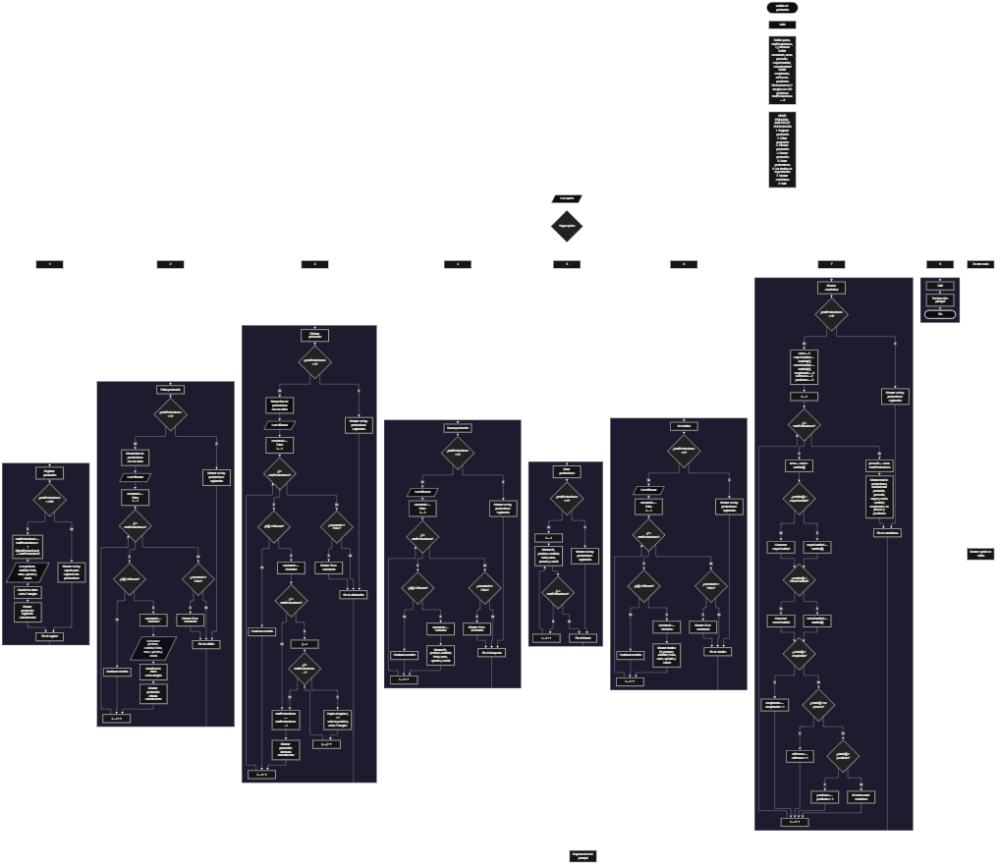

 

Este proyecto, llamado <b>análisis de producción</b>, fue desarrollado en <b>pseint</b> como un ejercicio práctico para fortalecer la lógica de programación mediante la creación de un sistema de gestión de producciones desde la consola. El programa cuenta con un menú principal de ocho opciones que permite <b>registrar, editar, eliminar, buscar, listar y consultar los detalles</b> de las producciones registradas, además de calcular estadísticas generales. Cada producción almacena información como el nombre del producto, la cantidad producida, la fecha, el turno, el nombre del operario y el estado de la producción, utilizando arreglos con una capacidad máxima de <b>100 producciones durante la ejecución</b>. Durante su desarrollo se aplicaron conceptos fundamentales de programación, como variables, arreglos, estructuras condicionales, ciclos repetitivos y estructuras de selección, además de procesos para buscar, modificar, eliminar y organizar registros. Este proyecto permite poner en práctica los conocimientos adquiridos en PSeInt y sirve como base para desarrollar sistemas de control de producción más avanzados utilizando otros lenguajes y tecnologías.

<h2 align="center">⚙️ Funcionamiento del menú principal</h2>

### ➕ Registrar producción

La opción <b>1) registrar producción</b> permite agregar una nueva producción al sistema. Antes de realizar el registro, el programa comprueba que la cantidad de producciones almacenadas sea menor a <b>100</b>, utilizando la condición <b>totalProducciones &lt; 100</b>. Si existe espacio disponible, la variable <b>totalProducciones</b> aumenta en uno y el programa asigna un identificador mediante la instrucción <b>id[totalProducciones] &lt;- totalProducciones</b>. A continuación, solicita el <b>nombre del producto, la cantidad producida, la fecha, el turno, el nombre del operario y el estado</b>. Los datos se almacenan en las posiciones correspondientes de sus respectivos arreglos. Finalmente, muestra el mensaje <b>"produccion registrada correctamente."</b>. Si se alcanza la capacidad máxima, presenta el mensaje <b>"no hay espacio para registrar mas producciones."</b>, impidiendo registrar otra producción.

### ✏️ Editar producción

La opción <b>2) editar producción</b> permite modificar la información de una producción registrada. Primero, el programa comprueba si existen registros mediante la variable <b>totalProducciones</b>. Si no hay producciones almacenadas, muestra el mensaje <b>"no hay producciones registradas."</b>. En caso contrario, presenta una lista con el ID, el producto, la cantidad, la fecha, el turno, el operario y el estado de cada producción. Después, solicita el ID de la producción que se desea editar y utiliza la variable <b>encontrado</b>, inicializada en <b>falso</b>, para controlar el resultado de la búsqueda. Mediante un ciclo <b>para</b>, recorre los identificadores almacenados y comprueba si alguno coincide con el valor introducido. Si encuentra una coincidencia, solicita los nuevos datos y actualiza directamente los valores de los arreglos correspondientes. Finalmente, muestra el mensaje <b>"produccion editada correctamente."</b>. Si no encuentra el ID solicitado, presenta el mensaje <b>"no se encontr&oacute; una produccion con ese id."</b>.

### 🗑️ Eliminar producción

La opción <b>3) eliminar producción</b> permite eliminar una producción mediante su ID. Antes de comenzar, el programa comprueba que existan producciones registradas. Si no hay registros, muestra el mensaje <b>"no hay producciones registradas."</b>. Si existen producciones, presenta una lista con sus datos y solicita el ID que se desea eliminar. Después, inicializa la variable lógica <b>encontrado</b> en <b>falso</b> y recorre los identificadores mediante un ciclo <b>para</b>. Cuando encuentra una coincidencia, cambia la variable a <b>verdadero</b>. Si la producción seleccionada no ocupa la última posición, utiliza otro ciclo <b>para</b>, controlado por la variable <b>j</b>, para desplazar una posición hacia atrás los datos de los arreglos <b>id, producto, cantidad, fecha, turno, operario y estado</b>. Posteriormente, disminuye <b>totalProducciones</b> en uno y muestra el mensaje <b>"produccion eliminada correctamente."</b>. Si no encuentra el ID solicitado, presenta el mensaje <b>"no se encontr&oacute; una produccion con ese id."</b>. El código original no limpia explícitamente la última posición que queda fuera del total activo.

### 🔎 Buscar producción

La opción <b>4) buscar producción</b> permite localizar una producción mediante su ID. Primero, el programa comprueba si existen producciones registradas. Si no hay registros, muestra el mensaje <b>"no hay producciones registradas."</b>. En caso contrario, solicita el identificador de la producción y establece la variable lógica <b>encontrado</b> en <b>falso</b>. A continuación, utiliza un ciclo <b>para</b> para recorrer el arreglo <b>id</b> y comparar sus valores con el identificador introducido mediante la condición <b>id[i] = idBuscar</b>. Cuando encuentra una coincidencia, cambia <b>encontrado</b> a <b>verdadero</b> y muestra el ID, el producto, la cantidad, la fecha, el turno, el operario y el estado. Si termina el recorrido sin encontrar coincidencias, presenta el mensaje <b>"no se encontr&oacute; una produccion con ese id."</b>.

### 📋 Listar producciones

La opción <b>5) listar producciones</b> permite visualizar todas las producciones registradas actualmente. Antes de mostrar los datos, el programa comprueba si <b>totalProducciones</b> es igual a cero. Si no existen registros, presenta el mensaje <b>"no hay producciones registradas."</b>. Si hay producciones disponibles, utiliza un ciclo <b>para</b> para recorrer los arreglos desde la primera posición hasta el total de registros almacenados. Durante el recorrido, muestra el ID, el producto, la cantidad, la fecha, el turno, el operario y el estado de cada producción en una misma línea. Esta función facilita consultar la información general de los registros sin necesidad de buscar cada producción individualmente.

### 📄 Ver detalles de la producción

La opción <b>6) ver detalles de la producción</b> permite consultar por separado toda la información de una producción específica. Primero, el programa comprueba si existen producciones registradas. Si no hay registros, muestra el mensaje <b>"no hay producciones registradas."</b>. En caso contrario, solicita el ID de la producción que se desea consultar e inicializa la variable <b>encontrado</b> en <b>falso</b>. Después, utiliza un ciclo <b>para</b> para recorrer los identificadores y comprobar si alguno coincide con el valor introducido. Si encuentra una coincidencia, muestra el ID, el producto, la cantidad, la fecha, el turno, el operario y el estado, cada uno en una línea independiente. Si no encuentra la producción solicitada, presenta el mensaje <b>"no se encontr&oacute; una produccion con ese id."</b>.

### 📊 Mostrar estadísticas

La opción <b>7) mostrar estadísticas</b> permite calcular un resumen general de las producciones registradas. Primero, el programa comprueba si existen registros; si no hay producciones, muestra el mensaje <b>"no hay producciones registradas."</b>. En caso contrario, inicializa <b>suma</b> en cero, establece <b>mayorCantidad</b> y <b>menorCantidad</b> con el valor de la primera cantidad registrada y pone en cero los contadores <b>completadas</b>, <b>enProceso</b> y <b>pendientes</b>. Mediante un ciclo <b>para</b>, recorre las cantidades para calcular la suma total y comparar cada valor con la cantidad mayor y menor. Durante el mismo recorrido, comprueba el contenido de <b>estado[i]</b> para contar las producciones con los estados <b>"completada"</b>, <b>"en proceso"</b> y <b>"pendiente"</b>. Al finalizar, calcula el promedio mediante <b>promedio &lt;- suma / totalProducciones</b> y muestra el total de producciones, la cantidad total producida, el promedio, la mayor producción, la menor producción y los conteos por estado.

### 🚪 Salir del menú principal

La opción <b>8) salir</b> está destinada a finalizar la ejecución del programa y muestra el mensaje <b>"gracias por utilizar analisis de produccion."</b>. El menú principal se encuentra dentro de una estructura repetitiva <b>repetir ... hasta que</b>, cuya condición final es <b>Hasta Que opcion = 8</b>. Por este motivo, cuando el usuario selecciona la opción 8, el ciclo termina después de mostrar el mensaje de despedida. Si se introduce un número que no corresponde a ninguna de las opciones definidas, el bloque <b>de otro modo</b> muestra el mensaje <b>"opci&oacute;n no v&aacute;lida."</b>.

<h2 align="center">🧠 Temas aplicados en el proyecto</h2>

### 📦 Variables

En este proyecto se utilizan variables para almacenar la opción seleccionada en el menú, controlar la cantidad de producciones registradas, recorrer los arreglos, identificar las producciones que se desean editar, eliminar o consultar, comprobar si se encontró un registro y calcular las estadísticas generales. Cada variable cumple una función específica dentro de las operaciones de gestión de la producción.

🔢 **opcion:** Almacena la opción seleccionada por el usuario en el menú principal.

📊 **totalProducciones:** Controla la cantidad actual de producciones registradas.

🔄 **i:** Funciona como contador en los ciclos <b>para</b> y permite recorrer las posiciones de los arreglos.

🔁 **j:** Controla el desplazamiento de los registros posteriores durante la eliminación de una producción.

🔎 **idBuscar:** Almacena el identificador introducido por el usuario para localizar una producción.

✅ **encontrado:** Variable lógica que indica si se encontró una producción con el ID solicitado.

➕ **suma:** Acumula las cantidades producidas para calcular el total.

📈 **promedio:** Almacena el promedio de las cantidades producidas.

⬆️ **mayorCantidad:** Guarda la mayor cantidad registrada entre las producciones activas.

⬇️ **menorCantidad:** Guarda la menor cantidad registrada entre las producciones activas.

✔️ **completadas:** Cuenta las producciones cuyo estado es exactamente `"completada"`.

🔄 **enProceso:** Cuenta las producciones cuyo estado es exactamente `"en proceso"`.

⏳ **pendientes:** Cuenta las producciones cuyo estado es exactamente `"pendiente"`.

### 🗃️ Arreglos

En este proyecto se utilizan siete arreglos relacionados entre sí para almacenar la información de cada producción. Cada arreglo tiene una capacidad de <b>100 posiciones</b> y utiliza el mismo índice para representar los datos correspondientes a una misma producción. Por ejemplo, la información de la producción ubicada en la posición <b>1</b> se encuentra distribuida entre <b>id[1], producto[1], cantidad[1], fecha[1], turno[1], operario[1] y estado[1]</b>. Esta organización permite recorrer, buscar, modificar, mostrar y eliminar los registros de manera coordinada.

🆔 **id[100]:** Almacena el identificador de cada producción.

📦 **producto[100]:** Almacena el nombre del producto elaborado.

🔢 **cantidad[100]:** Almacena la cantidad producida.

📅 **fecha[100]:** Almacena la fecha correspondiente a la producción.

🕒 **turno[100]:** Almacena el turno de trabajo.

👷 **operario[100]:** Almacena el nombre del operario responsable.

📌 **estado[100]:** Almacena el estado de cada producción, previsto en el programa como completada, en proceso o pendiente.

### 🔀 Estructuras condicionales

En este proyecto se utilizan las estructuras <b>si</b> y <b>sino</b> para comprobar si existe espacio disponible antes de registrar una producción, verificar si hay registros antes de realizar una operación, identificar una producción mediante su ID, decidir cuándo se deben desplazar los datos durante la eliminación y comparar las cantidades para calcular las estadísticas. También se utilizan condiciones anidadas para clasificar las producciones según su estado. Estas estructuras permiten que el programa ejecute diferentes instrucciones según los valores almacenados y los resultados de cada comprobación.

### 🔄 Estructuras repetitivas

En este proyecto se utilizan los ciclos <b>para</b> y <b>repetir ... hasta que</b>. Los ciclos <b>para</b> permiten recorrer los arreglos para listar las producciones, localizar identificadores, editar registros y consultar detalles. También se utilizan durante la eliminación para desplazar los datos posteriores una posición hacia atrás y durante las estadísticas para sumar las cantidades, encontrar los valores mayor y menor y contar las producciones por estado. Por otro lado, el ciclo <b>repetir ... hasta que</b> mantiene activo el menú principal hasta que el usuario selecciona la opción 8.

### 🎯 Estructura según

El programa utiliza la estructura <b>segun</b> para evaluar el valor de la variable <b>opcion</b> y ejecutar el bloque de instrucciones correspondiente. Cada caso representa una operación del sistema: <b>registrar, editar, eliminar, buscar, listar, ver detalles, mostrar estadísticas o salir</b>. También se incluye el bloque <b>de otro modo</b>, que muestra el mensaje <b>"opci&oacute;n no v&aacute;lida."</b> cuando el valor introducido no coincide con ninguna de las ocho opciones del menú.

### 🔢 Dimensionamiento de arreglos

El programa utiliza la instrucción <b>dimension</b> para establecer una capacidad de <b>100 posiciones</b> en cada uno de los siete arreglos. Esto permite administrar hasta 100 producciones durante la ejecución. La variable <b>totalProducciones</b> controla cuántos registros se consideran activos, por lo que los ciclos recorren las posiciones comprendidas entre <b>1</b> y el total actual de producciones. La comprobación <b>totalProducciones &lt; 100</b> evita registrar más producciones de las que permite la capacidad definida.

### 🔄 Reorganización de registros

Cuando se elimina una producción que no ocupa la última posición, el programa utiliza el ciclo <b>para</b>, controlado por la variable <b>j</b>, para copiar los datos de la posición siguiente sobre la posición actual. Este desplazamiento se realiza en los siete arreglos: <b>id, producto, cantidad, fecha, turno, operario y estado</b>. Después, la variable <b>totalProducciones</b> disminuye en uno, por lo que el registro eliminado deja de formar parte del conjunto de posiciones activas. El código original no borra explícitamente los valores de la última posición después del desplazamiento; sin embargo, esa posición queda fuera del total activo mientras no vuelva a utilizarse.

<h2 align="center">¿Cómo se implementaron las operaciones CRUD en el proyecto?</h2>

Las operaciones <b>CRUD</b> se implementaron mediante las opciones del menú principal para administrar las producciones registradas. La operación <b>crear</b> corresponde a <b>registrar producción</b>, donde se introducen los datos de un nuevo registro. La operación <b>leer</b> se realiza mediante <b>buscar producción, listar producciones y ver detalles de la producción</b>, que permiten consultar la información almacenada. La operación <b>actualizar</b> corresponde a <b>editar producción</b>, donde se modifican los datos de una producción existente. Por último, la operación <b>eliminar</b> se implementa mediante <b>eliminar producción</b>, que desplaza los registros posteriores y disminuye el contador. Estas operaciones utilizan variables, arreglos, condicionales y ciclos para gestionar temporalmente la información durante la ejecución del programa.

<h2 align="center">Diagrama de flujo del proyecto</h2>

<h2 align="center">🛡️ Validaciones del programa</h2>

### 📭 No existen producciones registradas

Esta comprobación se utiliza en las opciones de <b>editar, eliminar, buscar, listar, ver detalles y mostrar estadísticas</b>. El programa verifica si <b>totalProducciones</b> es igual a <b>0</b>. Si no existen producciones registradas, muestra el mensaje <b>"no hay producciones registradas."</b> y no ejecuta el proceso que requiere información almacenada. Esta validación evita realizar los recorridos y cálculos de estas operaciones cuando no hay registros activos.

### ⚠️ Capacidad máxima alcanzada

Esta validación se utiliza durante el registro de producciones. El programa comprueba si <b>totalProducciones &lt; 100</b> antes de agregar un nuevo registro. Si existe espacio disponible, incrementa el contador y solicita los datos de la producción. Si se alcanza la capacidad máxima, muestra el mensaje <b>"no hay espacio para registrar mas producciones."</b> e impide registrar otra producción.

### ❌ Producción no encontrada

Esta validación se utiliza en las operaciones de <b>editar, eliminar, buscar y ver detalles</b>. El programa inicializa la variable lógica <b>encontrado</b> con el valor <b>falso</b> y recorre el arreglo de identificadores para comparar sus valores con el ID introducido. Cuando encuentra una coincidencia, cambia la variable a <b>verdadero</b> y ejecuta la operación correspondiente. Si finaliza el recorrido y la variable continúa siendo <b>falso</b>, muestra el mensaje <b>"no se encontr&oacute; una produccion con ese id."</b>.

### 📊 Clasificación por estado

Durante el cálculo de estadísticas, el programa compara cada valor del arreglo <b>estado</b> con los textos <b>"completada"</b>, <b>"en proceso"</b> y <b>"pendiente"</b>. Si coincide con alguno de ellos, incrementa el contador correspondiente. El código original no valida el estado durante el registro o la edición, por lo que los valores diferentes de esos tres textos no se incluyen en los conteos mostrados por las estadísticas.

### 🔢 Cálculo de estadísticas

Antes de calcular el promedio, la suma, la cantidad mayor y la cantidad menor, el programa comprueba que existan producciones registradas. Si hay registros, inicializa la suma y los contadores, toma la primera cantidad como valor inicial de <b>mayorCantidad</b> y <b>menorCantidad</b>, y recorre las cantidades almacenadas. Finalmente, calcula el promedio dividiendo la suma entre <b>totalProducciones</b>. Esta comprobación evita realizar la división cuando el contador es cero.

### ⚠️ Opción inválida

La estructura <b>segun</b> incluye el bloque <b>de otro modo</b>, que muestra el mensaje <b>"opci&oacute;n no v&aacute;lida."</b> cuando el usuario introduce un valor que no corresponde a ninguna de las opciones del menú. Esta respuesta permite informar al usuario de que debe seleccionar una de las opciones disponibles.

<h2 align="center">🎯 Objetivo del proyecto</h2>

El objetivo principal de este proyecto es fortalecer la <b>lógica de programación</b> mediante el desarrollo de un sistema de gestión y análisis de producción en <b>pseint</b>. A través de su construcción se busca aplicar los conocimientos adquiridos sobre variables, arreglos, estructuras condicionales, ciclos repetitivos y estructuras de selección, integrándolos para resolver un problema de manera organizada. Además, el proyecto permite comprender cómo registrar, consultar, modificar y eliminar producciones, así como calcular estadísticas sobre las cantidades fabricadas y los estados de los registros. De esta manera, se establece una base para desarrollar sistemas de control de producción más completos con otros lenguajes y tecnologías.

